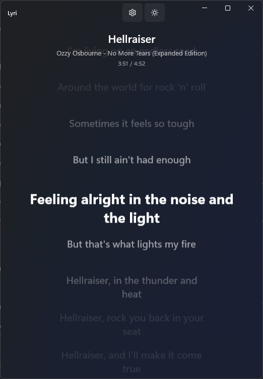
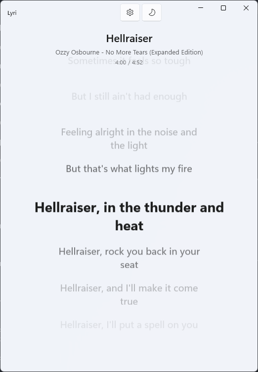
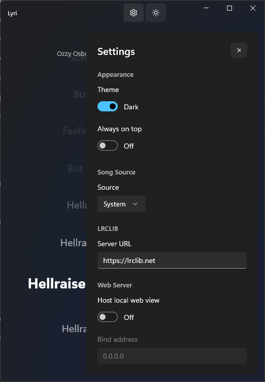
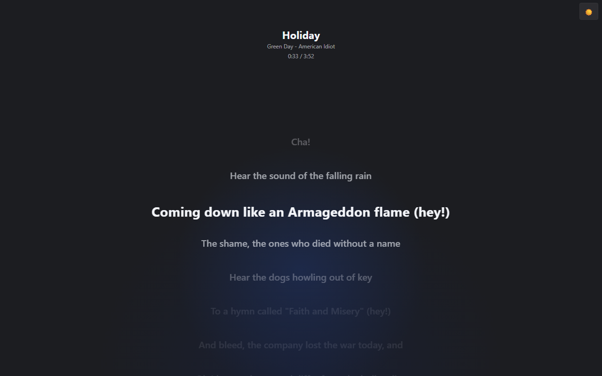

# Lyri

Live, synced lyrics for whatever is playing on your PC. Lyrics are fetched from [LRCLIB](https://lrclib.net) and are scrolled along with the playing song. A local webview allows you to share the lyrics with other devices (webbrowsers or Lyri clients) on your network.

<p align="center">
  
  
  
</p>

## Features

- Follows the current track of any player that uses the Windows media controls or MPRIS on Linux
- Synced lyrics from LRCLIB (including custom LRCLIB servers)
- Native platform-UI apps (WinUI on Windows, GTK 4 on Linux)
- Host a web view on your network so other devices can follow along (with optional controls)
- Mirror another Lyri instance instead of the local player

<p align="center">
  
</p>

## Building

Both apps embed the web view, so build it first (requires [pnpm](https://pnpm.io)):

```sh
pnpm -C apps/lyri-web install
pnpm -C apps/lyri-web build
```

### Windows

Requirements: Windows 11, [Rust](https://rustup.rs) and the
[Windows App Runtime](https://learn.microsoft.com/windows/apps/windows-app-sdk/downloads) 2.6.4 or newer.

```sh
cargo run -p lyri-windows --release
```

To build an MSIX package, run `cargo make msix` in `apps/lyri-windows`
(requires [cargo-make](https://github.com/sagiegurari/cargo-make) and the
`winapp` CLI).

### Linux

Requirements: [Rust](https://rustup.rs) and GTK 4.12 or newer with its development files
(`libgtk-4-dev` on Debian/Ubuntu).

```sh
cargo run -p lyri-linux --release
```

To show the app icon, install the desktop file and icons:

```sh
cp target/release/lyri-gtk ~/.local/bin/
cp apps/lyri-linux/data/dev.lyri.Lyri.desktop ~/.local/share/applications/
cp -r apps/lyri-linux/data/icons ~/.local/share/
```

## Project layout

| Path                    | What it is                                                                                                         |
| ----------------------- | ------------------------------------------------------------------------------------------------------------------ |
| `apps/lyri-windows`     | The Windows app (using [windows-reactor](https://github.com/microsoft/windows-rs/tree/master/crates/libs/reactor)) |
| `apps/lyri-linux`       | The Linux app (using [GTK 4](https://gtk-rs.org))                                                                  |
| `apps/lyri-web`         | The web view (using Svelte)                                                                                        |
| `crates/lyri-core`      | Lyrics parsing and shared types                                                                                    |
| `crates/lyri-providers` | Lyrics lookup (LRCLIB)                                                                                             |
| `crates/lyri-server`    | Web view host, client and protocol                                                                                 |

## License

[MIT](LICENSE)
